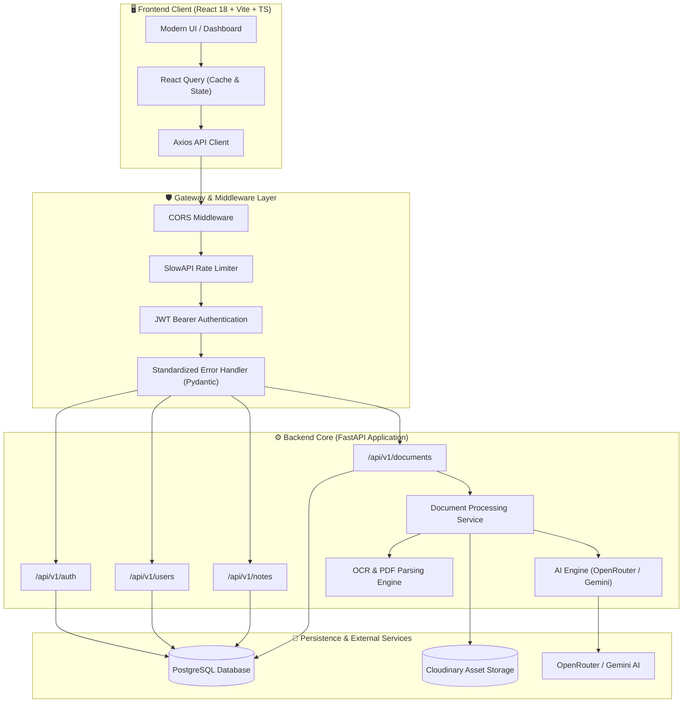

# Acadexa AI 🚀

[](https://github.com/riazaslam029/acadexa-ai/actions/workflows/ci.yml)
[](https://fastapi.tiangolo.com)
[](https://react.dev)
[](https://www.typescriptlang.org)
[](https://www.python.org)
[](https://www.postgresql.org)
[](https://www.docker.com)
[](LICENSE)

An intelligent educational copilot and learning platform that transforms complex study materials—including PDFs, Word documents, raw text, and scanned textbook pages—into interactive study aids such as AI-grounded document chat, active recall flashcards, multiple-choice quizzes, structured roadmaps, and synthesized study notes.

---

## 📑 Table of Contents

- [Overview](#overview)
- [System Architecture](#system-architecture)
- [Core Features](#core-features)
- [Tech Stack](#tech-stack)
- [Screenshots & UI Preview](#screenshots--ui-preview)
- [Getting Started](#getting-started)
  - [Prerequisites](#prerequisites)
  - [Docker Compose Quickstart (Recommended)](#docker-compose-quickstart-recommended)
  - [Manual Local Development Setup](#manual-local-development-setup)
- [Running Automated Tests](#running-automated-tests)
- [API Reference](#api-reference)
- [Future Improvements](#future-improvements)
- [Contributing](#contributing)
- [License](#license)

---

## 🌟 Overview

Students and educators often struggle with information overload across lecture slides, research papers, and textbooks. **Acadexa AI** solves this by providing a unified workflow:
1. **Ingest & Extract**: Upload course syllabi, lecture slides, scanned book pages, or articles in PDF, DOCX, TXT, PNG, or JPEG format.
2. **AI Document Intelligence**: Automatically extract full text, trigger optical character recognition (OCR) when text layers are absent, and generate executive summaries.
3. **Conversational Learning**: Ask questions grounded directly against the document context with persistent chat history.
4. **Adaptive Study Tooling**: Convert document contents on demand into 9 distinct study artifacts (flashcards, MCQs, quizzes, ELI5 summaries, roadmaps, and multi-language translations).

---

## 🏛️ System Architecture



---

## ✨ Core Features

- **🔐 Robust Authentication & Security**:
  - Secure user registration and OAuth2 password flow with JWT access tokens.
  - Strong password hashing with Argon2 via `pwdlib`.
  - Pydantic v2 input validation with unified, structured error responses.
  - Per-IP rate limiting powered by `slowapi`.

- **📄 Document Ingestion & Multimodal OCR**:
  - Supports `.pdf`, `.docx`, `.txt`, `.png`, `.jpeg`, and `.jpg`.
  - Automated PDF text extraction with PyMuPDF.
  - Integrated PyTesseract OCR fallback for scanned materials and images.
  - Optional cloud storage offloading via Cloudinary.

- **💬 Grounded Document Chat**:
  - Context-aware question answering strictly grounded in document text.
  - Complete conversational history tracking per document.

- **🧠 9 Intelligent AI Artifact Generators**:
  1. **Flashcards**: Front/back question-answer pairs for spaced repetition.
  2. **Multiple-Choice Questions (MCQs)**: Questions with 4 options, correct answers, and explanations.
  3. **Timed Quizzes**: Comprehensive tests with scoring keys.
  4. **Key Points**: Bulleted conceptual digests of critical topics.
  5. **Study Notes**: In-depth, well-structured revision notes.
  6. **ELI5 (Explain Like I'm 5)**: Intuitive, simplified conceptual analogies.
  7. **Learning Roadmaps**: Step-by-step milestone guides for curriculum mastery.
  8. **Study Plans**: Structured study calendar and schedule breakdown.
  9. **Multi-language Translation**: Seamless translation into Urdu, Arabic, French, and German.

- **📝 Note Workspace**:
  - Full CRUD note-taking with category tagging and real-time updates.

- **📊 Student Dashboard**:
  - Real-time metrics: document count, generated study aids, storage consumption, and recent uploads.

---

## 🛠️ Tech Stack

| Domain | Technology | Description |
| :--- | :--- | :--- |
| **Backend Framework** | [FastAPI](https://fastapi.tiangolo.com/) | High-performance Python async web framework |
| **Data Validation** | [Pydantic v2](https://docs.pydantic.dev/) | Strict type enforcement, validation, and serialization |
| **Database ORM** | [SQLAlchemy 2.0](https://www.sqlalchemy.org/) | Modern ORM with relationship mapping and migrations |
| **Database Migrations** | [Alembic](https://alembic.sqlalchemy.org/) | Database schema change tracking and migration runner |
| **Relational Database** | [PostgreSQL](https://www.postgresql.org/) / Neon | ACID-compliant relational storage |
| **Primary AI Gateway** | [OpenRouter](https://openrouter.ai/) | High-throughput access to Gemini 2.5 Flash / Claude / GPT |
| **Fallback AI Provider** | [Google Gemini](https://ai.google.dev/) | Direct Gemini API integration fallback |
| **OCR Engine** | [PyTesseract](https://pypi.org/project/pytesseract/) + Tesseract | Optical character recognition for scanned texts |
| **Document Processing** | [PyMuPDF](https://pymupdf.readthedocs.io/) & [python-docx](https://python-docx.readthedocs.io/) | Fast parsing of PDF and Word files |
| **Frontend Framework** | [React 18](https://react.dev/) + [Vite](https://vitejs.dev/) | Fast build tool and reactive component UI |
| **Styling** | [Tailwind CSS](https://tailwindcss.com/) | Utility-first responsive design and dark mode styling |
| **Server State** | [TanStack React Query](https://tanstack.com/query) | Async data fetching, caching, and mutation state |
| **Testing** | [pytest](https://pytest.org/) & [Vitest](https://vitest.dev/) | Comprehensive backend and frontend testing suites |
| **DevOps** | [Docker](https://www.docker.com/) & GitHub Actions | Containerization and continuous integration |

---

## 📸 Screenshots & UI Preview

<div align="center">
  
</div>

<br/>

| Feature | Preview Placeholder |
| :--- | :--- |
| **Student Dashboard** | `` <br/> *Overview of study metrics, recent documents, and storage tracking.* |
| **Document Intelligence & Chat** | `` <br/> *Live Q&A grounded against uploaded PDF textbooks.* |
| **AI Study Artifact Generator** | `` <br/> *Interactive flashcards, MCQs, and custom quizzes.* |
| **Revision Notes Manager** | `` <br/> *Markdown-enabled personal revision workspace.* |

---

## 🚀 Getting Started

### Prerequisites

- [Docker](https://docs.docker.com/get-docker/) & [Docker Compose](https://docs.docker.com/compose/) **OR**
- [Python 3.12+](https://www.python.org/downloads/)
- [Node.js 18+](https://nodejs.org/) & `npm`
- [Tesseract OCR](https://github.com/tesseract-ocr/tesseract) (optional for local non-Docker OCR)

---

### Docker Compose Quickstart (Recommended)

1. **Clone the repository:**
   ```bash
   git clone https://github.com/riazaslam029/acadexa-ai.git
   cd acadexa-ai
   ```

2. **Configure environment variables:**
   ```bash
   cp .env.example .env
   ```
   Add your `OPENROUTER_API_KEY` (and optionally `CLOUDINARY_*` credentials) inside `.env`.

3. **Start the containers:**
   ```bash
   docker compose up --build
   ```

4. **Access the application:**
   - **Backend API**: `http://localhost:8000`
   - **Interactive API Docs (Swagger)**: `http://localhost:8000/docs`
   - **Alternative Docs (ReDoc)**: `http://localhost:8000/redoc`
   - **Database (PostgreSQL)**: `localhost:5432`

---

### Manual Local Development Setup

#### 1. Backend Setup

```bash
# Navigate to the repository root
cd acadexa-ai

# Create and activate a Python virtual environment
python -m venv venv
# On Windows:
venv\Scripts\activate
# On Linux/macOS:
source venv/bin/activate

# Install backend dependencies
pip install -r backend/requirements.txt

# Copy environment file
cp .env.example .env

# Run database migrations (or run server with automatic table creation)
cd backend
alembic upgrade head

# Start FastAPI backend server
uvicorn app.main:app --reload --host 0.0.0.0 --port 8000
```

#### 2. Frontend Setup

In a separate terminal:

```bash
cd frontend

# Install Node dependencies
npm install

# Start Vite development server
npm run dev
```

Visit `http://localhost:5173` in your browser.

---

## 🧪 Running Automated Tests

Acadexa AI includes automated test suites for both backend and frontend layers:

### Backend Tests (pytest)

Run tests directly from the repository root:

```bash
# Run full test suite with verbose reporting
pytest

# Run tests with short progress summary
pytest -q

# Run with coverage report
pytest --cov=backend/app backend/tests/
```

### Frontend Tests (Vitest)

```bash
cd frontend

# Run unit and component tests
npm run test

# Run TypeScript typechecks
npm run typecheck

# Run linter
npm run lint
```

---

## 📡 API Reference

Interactive API documentation with live testing is available at `/docs` (Swagger UI) and `/redoc`.

### Health & System
| Method | Endpoint | Auth | Description |
| :--- | :--- | :---: | :--- |
| `GET` | `/` | ❌ | Root greeting and API information |
| `GET` | `/health` | ❌ | Service health status check |
| `GET` | `/api/test` | ❌ | Frontend-backend connectivity ping |

### Authentication (`/api/v1/auth`)
| Method | Endpoint | Auth | Description |
| :--- | :--- | :---: | :--- |
| `POST` | `/api/v1/auth/register` | ❌ | Register new account (`UserCreate` payload) |
| `POST` | `/api/v1/auth/login` | ❌ | OAuth2 password flow login; returns JWT `Token` |

### User Management (`/api/v1/users`)
| Method | Endpoint | Auth | Description |
| :--- | :--- | :---: | :--- |
| `GET` | `/api/v1/users/me` | ✅ | Get profile of currently logged-in user |
| `PATCH` | `/api/v1/users/me` | ✅ | Update profile (`name`, `profile_image`) |
| `POST` | `/api/v1/users/me/change-password` | ✅ | Change account password |
| `DELETE` | `/api/v1/users/me` | ✅ | Permanently delete account and all data |
| `GET` | `/api/v1/users/dashboard` | ✅ | Get usage metrics and recent uploads |

### Study Notes (`/api/v1/notes`)
| Method | Endpoint | Auth | Description |
| :--- | :--- | :---: | :--- |
| `POST` | `/api/v1/notes` | ✅ | Create a new study note |
| `GET` | `/api/v1/notes` | ✅ | List all study notes for current user |
| `GET` | `/api/v1/notes/{note_id}` | ✅ | Retrieve a specific note by ID |
| `PUT` | `/api/v1/notes/{note_id}` | ✅ | Update note content, title, or subject |
| `DELETE` | `/api/v1/notes/{note_id}` | ✅ | Delete a note |

### Documents (`/api/v1/documents`)
| Method | Endpoint | Auth | Description |
| :--- | :--- | :---: | :--- |
| `POST` | `/api/v1/documents/upload` | ✅ | Upload document (PDF, DOCX, TXT, PNG, JPG) |
| `GET` | `/api/v1/documents` | ✅ | List all documents owned by user |
| `GET` | `/api/v1/documents/{document_id}` | ✅ | Get document details and extracted text |
| `DELETE` | `/api/v1/documents/{document_id}` | ✅ | Delete document and associated artifacts |
| `GET` | `/api/v1/documents/search` | ✅ | Search user documents by keyword (`?q=query`) |

### AI Document Chat & Artifacts
| Method | Endpoint | Auth | Description |
| :--- | :--- | :---: | :--- |
| `POST` | `/api/v1/documents/{id}/chat` | ✅ | Ask question grounded in document context |
| `GET` | `/api/v1/documents/{id}/chat/history` | ✅ | Get chat history for document |
| `POST` | `/api/v1/documents/{id}/flashcards` | ✅ | Generate flashcards (`difficulty`, `count`) |
| `GET` | `/api/v1/documents/{id}/flashcards` | ✅ | List generated flashcard sets |
| `POST` | `/api/v1/documents/{id}/mcqs` | ✅ | Generate multiple-choice question sets |
| `GET` | `/api/v1/documents/{id}/mcqs` | ✅ | List generated MCQ sets |
| `POST` | `/api/v1/documents/{id}/quiz` | ✅ | Generate comprehensive timed quizzes |
| `GET` | `/api/v1/documents/{id}/quiz` | ✅ | List quizzes |
| `POST` | `/api/v1/documents/{id}/key-points` | ✅ | Extract conceptual key points |
| `POST` | `/api/v1/documents/{id}/notes` | ✅ | Synthesize comprehensive study notes |
| `POST` | `/api/v1/documents/{id}/eli5` | ✅ | Generate simplified 'Explain Like I'm 5' |
| `POST` | `/api/v1/documents/{id}/roadmap` | ✅ | Generate structured learning roadmap |
| `POST` | `/api/v1/documents/{id}/study-plan` | ✅ | Create structured study schedule |
| `POST` | `/api/v1/documents/{id}/translation` | ✅ | Translate content (`language=urdu/french/...`) |
| `DELETE` | `/api/v1/documents/artifacts/{artifact_id}` | ✅ | Delete an AI artifact |

---

## 🔮 Future Improvements

1. **Semantic Vector Search & RAG**:
   - Integrate vector embeddings (`pgvector` or `Qdrant`) with chunking strategies to support very large textbooks (500+ pages) without exceeding context windows.
   - Implement hybrid keyword + dense vector retrieval for improved answer accuracy.

2. **Real-time LLM Streaming**:
   - Upgrade document chat and artifact generation endpoints to stream tokens via Server-Sent Events (SSE) or WebSockets for lower perceived latency.

3. **Spaced Repetition System (SRS)**:
   - Implement the SM-2 or FSRS algorithm for flashcards to schedule smart daily review intervals based on recall performance.

4. **Speech & Audio Intelligence**:
   - Add automated lecture audio transcription (Whisper API) to let students record live lectures and turn them into synchronized study guides.

5. **Collaborative Study Rooms**:
   - Real-time study rooms with shared document annotations, peer quiz competitions, and group flashcard decks.

6. **OAuth2 Single Sign-On (SSO)**:
   - Provide one-click social authentication via Google, GitHub, and institutional SAML/SSO.

7. **Export & Cross-Platform Integrations**:
   - One-click export to Anki (`.apkg`), Notion, Quizlet, and formatted PDF study booklets.

---

## 🤝 Contributing

Contributions are welcome! Please read [CONTRIBUTING.md](docs/CONTRIBUTING.md) for details on our code of conduct, development standards, and conventional commit guidelines.

1. Fork the Project
2. Create your Feature Branch (`git checkout -b feat/amazing-feature`)
3. Commit your Changes (`git commit -m 'feat: add amazing feature'`)
4. Push to the Branch (`git push origin feat/amazing-feature`)
5. Open a Pull Request

---

## 📄 License

This project is open-source and licensed under the [MIT License](LICENSE).